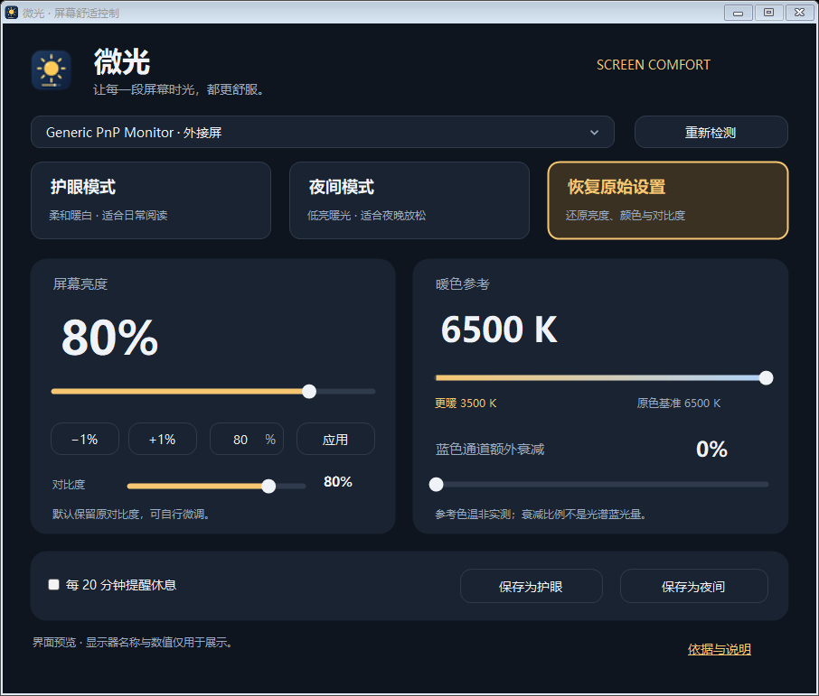

# 微光 · Weiguang

Windows 屏幕舒适调节工具。通过显示器硬件接口调节亮度、RGB 增益及对比度，提供护眼和夜间预设、参数保存、休息提醒与原始设置恢复。



## 使用

下载 `releases/Weiguang-portable.zip`，解压到可写目录后运行 `Weiguang.exe`。无需安装、无需联网，也不添加开机启动。不要直接在压缩包内运行。

- 亮度：滑块、1% 步进按钮，或输入整数后点击“应用”／按回车。
- 暖色与蓝色增益：支持 RGB 控制的显示器可用。色温为近似参考值。
- 预设：可将当前参数保存为护眼或夜间组合。
- 最小化后在托盘运行；双击托盘图标重新打开。
- 关闭窗口会恢复修改前的屏幕设置；异常退出后，下次启动尝试根据本地记录恢复。

外接显示器一般需要启用 DDC/CI。具体可用功能取决于显示器及连接方式；不支持 RGB 控制时，颜色模式不可用。程序不能保证适配所有设备。

## 从源码构建

需要 Windows 和 .NET Framework 自带的 64 位 C# 编译器。双击 `build.cmd`，或在 PowerShell 运行：

```powershell
.\build.ps1
```

生成文件位于 `bin/Weiguang.exe`，同目录包含使用说明和依据文档。无需额外 NuGet 依赖。

## 检查

```powershell
.\tests\run.ps1
```

检查键盘激活、禁用状态、亮度数值上下限、非法输入回退及按钮圆角背景，并离屏生成界面预览。该检查不写入显示器设置，不代替不同硬件上的实际兼容性测试。

## 项目结构

| 文件 | 用途 |
| --- | --- |
| `Brightness.cs` | 显示器枚举、硬件亮度接口与启动入口 |
| `ColorControl.cs` | RGB、对比度、预设与恢复记录 |
| `ComfortWindow.cs` | 深色界面及自绘控件 |
| `build.ps1` / `build.cmd` | Windows 构建入口 |
| `tests/` | 不写入显示器设置的控件检查 |
| `releases/` | 可运行的便携版 |

## 本地数据

`comfort-settings.xml` 保存个人预设；`recovery/` 保存待恢复的显示器原始设置。这些运行时文件不包含在项目发布包内，也被 Git 忽略。若存在待恢复记录，请先正常退出旧版本、确认恢复完成，再更换程序目录。

暖色参考与蓝色增益衰减不代表光谱蓝光量，也不是医学防护指标。具体说明见随程序附带的说明文档。
